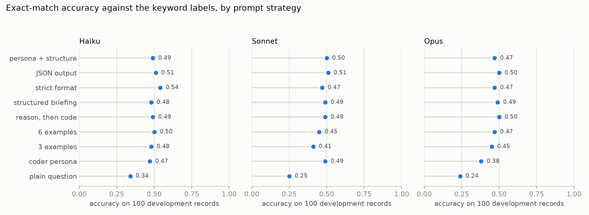
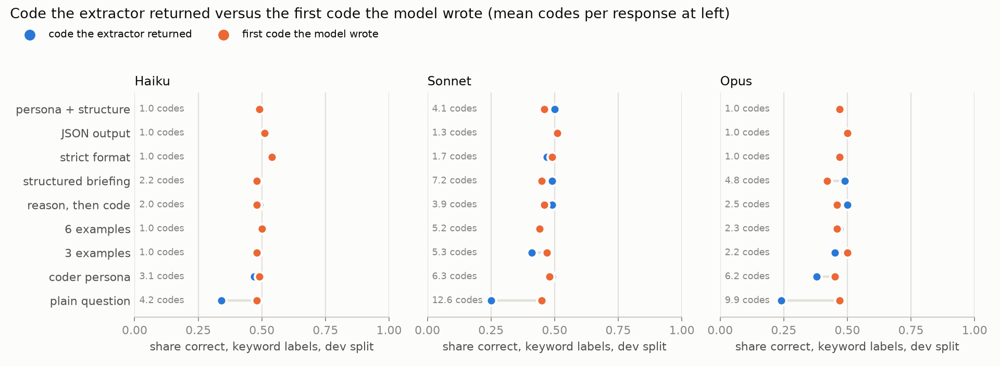

# What does prompt engineering change when the model already knows the codes?

A methods study, and the companion to
[`icd10am-llm-coding`](https://github.com/itsgichia/icd10am-llm-coding). That
study asked how far prompt engineering could take a 0.5B-parameter model on
assigning three-character ICD-10-AM principal diagnosis categories from a
hospital course summary, and measured the answer: exact-match accuracy was
0.000 under every one of nine prompting strategies, because the model had not
memorised the code table and no prompt can supply it.

This repository runs the **same nine strategies, the same record selection
rule, the same weak-labelling rule, the same post-processor and the same
metrics** against three current Claude models through the Claude API: Haiku
5.5, Sonnet 5.5 and Opus 5.5. Nothing else changes, so every difference in
the results is the model.

> **This is not a clinical coding tool.** It must not be used for real clinical
> coding, casemix classification, activity-based funding or billing.

## Findings

Three models, nine strategies, 100 development and 100 held-out test records,
4,200 requests, about US$12 at Message Batches prices.

1. **Every well-parsed strategy scores the same, on every model.** Against the
   keyword labels, each strategy that yields one clean code lands between 0.45
   and 0.54 on both splits for all three models. The development winners score
   0.51 (Haiku), 0.51 (Sonnet) and 0.52 (Opus) on the test split. The three
   tiers are indistinguishable at n = 100, and all of them are far from the
   Qwen result of 0.000.
2. **Prompt strategy changes what the extractor can read, not what the model
   thinks.** The first code each model writes is right 42 to 54% of the time
   under every strategy, the plain question included. The plain question
   nonetheless scores 0.24 to 0.38, because its answer is an essay with four
   (Haiku), ten (Opus) or thirteen (Sonnet) codes in it and the extractor,
   which prefers the last answer cue, returns a history or external-cause
   code from the discussion. A format contract or a JSON schema collapses the
   answer to one code and closes the gap.
3. **Few-shot examples do not help.** With three or six worked examples no
   model gains, accuracy on records whose label was not among the example
   codes equals overall accuracy, and example echo is 4 to 10%. Sonnet still
   writes five codes per answer with the examples in front of it.
4. **The keyword labels are the ceiling, and they were kept as provided.** The
   three models give the same modal code on 81 of 100 development and 82 of
   100 test records. The keyword label agrees with that unanimous code on only
   47 and 46 of them. Some of the disagreements are checkable against the
   classification itself: cholecystitis with a documented stone labelled K81
   where ICD-10-AM places it at K80, a retinal vein occlusion labelled by the
   comorbidity E11, every deep vein thrombosis labelled I82 where lower-limb
   DVT sits at I80. The labels were not corrected, so that the two studies
   stay comparable and no label derived from a Claude model enters the
   scoring. Accuracy here therefore measures agreement with a keyword rule,
   not with a clinical coder, and about 0.5 is where that agreement tops out.
5. **Haiku costs 3% of Opus for the same score.**



## Design

**Records.** Hospital-course text from the public `AGBonnet/augmented-clinical-notes`
set on the Hugging Face Hub, with the stated-diagnosis sections redacted from
what the model sees. The selection rule (scan the first 40,000 rows, keep
unique notes of 600 to 2,000 characters whose diagnosis section matches
exactly one labelling rule, shuffle with seed 20260321, take 100 development
and 100 test records) is identical to the Qwen study's, so the ten-record
splits used there are the first ten of each split here. The cached splits are
in `data/`.

**Labels.** The weak labels (`data/labels.jsonl`) come from a keyword rule
over the redacted diagnosis section, exactly as in the Qwen study. They are
used as provided; see finding 4 for what that means.

**Strategies.** The nine prompt templates from the Qwen study, unchanged:
plain question, strict format, coder persona, three and six examples, reason
then code, structured briefing, JSON output, persona plus structure. Every
strategy runs on the development split; the development winner plus fixed
comparators, five test strategies in all, run on the test split.

**Models and settings.** `claude-haiku-5-5`, `claude-sonnet-5-5`,
`claude-opus-5-5`, effort `low`, 4,096 output tokens, system turn carried as
the API system prompt. Requests go through the Message Batches API. Every raw
response is cached under `results/raw/` keyed by model, template, record,
effort and the rendered prompt.

**Extraction.** The Qwen study's three-layer extractor (bare code, JSON, answer
cue, then regex fallback) is used unchanged so the two studies stay
comparable. Its behaviour on long answers is itself a result; see below.

## Results

### Test split, 100 held-out records

Development winner first, then the fixed comparators. Format validity was
1.00 for every strategy except one Haiku run at 0.99.

| Model | Strategy | Accuracy | Chapter agreement | Mean output tokens |
| --- | --- | --- | --- | --- |
| Haiku | strict format (dev winner) | 0.51 | 0.77 | 283 |
| Haiku | six examples | 0.50 | 0.75 | 376 |
| Haiku | persona + structure | 0.50 | 0.76 | 290 |
| Haiku | structured briefing | 0.45 | 0.72 | 529 |
| Haiku | plain question | 0.38 | 0.59 | 1,062 |
| Sonnet | JSON output (dev winner) | 0.51 | 0.73 | 54 |
| Sonnet | structured briefing | 0.50 | 0.75 | 318 |
| Sonnet | strict format | 0.47 | 0.73 | 36 |
| Sonnet | six examples | 0.46 | 0.75 | 202 |
| Sonnet | plain question | 0.27 | 0.51 | 653 |
| Opus | reason, then code (dev winner) | 0.52 | 0.77 | 266 |
| Opus | structured briefing | 0.49 | 0.73 | 510 |
| Opus | strict format | 0.49 | 0.77 | 101 |
| Opus | six examples | 0.45 | 0.73 | 210 |
| Opus | plain question | 0.29 | 0.52 | 1,024 |

Output tokens include reasoning tokens. Full per-strategy tables for both
splits: `results/<model>/summary.csv`, with per-record predictions beside them.

### The extractor, not the model, separates the strategies

`scripts/parse_gap.py` reads every full response from the cache and asks two
questions that need no extractor: how many category-shaped codes did the
model write, and was the first one right?



| Sonnet, development split | Pipeline accuracy | First code correct | Label mentioned anywhere | Codes per response |
| --- | --- | --- | --- | --- |
| plain question | 0.25 | 0.45 | 0.83 | 12.6 |
| six examples | 0.45 | 0.44 | 0.68 | 5.2 |
| coder persona | 0.49 | 0.48 | 0.72 | 6.3 |
| strict format | 0.47 | 0.49 | 0.51 | 1.7 |
| JSON output | 0.51 | 0.51 | 0.51 | 1.3 |
| reason, then code | 0.49 | 0.46 | 0.59 | 3.9 |
| persona + structure | 0.50 | 0.46 | 0.63 | 4.1 |

Asked the plain question, Sonnet writes the principal code in bold, then the
fourth-character options, the history codes it considered and the
complication codes it rejected. The extractor's answer-cue layer prefers the
last cue in the text, a rule tuned to a small model that restates its answer,
and so returns a Z85 or a Y83 from the discussion. The "label mentioned
anywhere" column is an upper bound, not a fair ceiling, because it counts
codes the model raised in order to reject them.

Haiku writes four codes per plain answer against Sonnet's thirteen and Opus's
ten, which is why its baseline loses least. This reverses the Qwen result,
where the small model's failures were formatting failures and a format
contract was the whole gain: here the model's judgement is flat across
prompts and the contract is what makes it legible to software.

### Few-shot examples

| Strategy | Model | Accuracy | Accuracy on records whose label was not an example code | Example echo rate |
| --- | --- | --- | --- | --- |
| three examples | Haiku | 0.48 | 0.47 | 0.04 |
| six examples | Haiku | 0.50 | 0.49 | 0.10 |
| three examples | Sonnet | 0.41 | 0.41 | 0.05 |
| six examples | Sonnet | 0.45 | 0.43 | 0.09 |
| three examples | Opus | 0.45 | 0.45 | 0.04 |
| six examples | Opus | 0.47 | 0.47 | 0.09 |

Development split. No model gains from examples and no model is anchored by
them. In the Qwen study every six-example strategy answered only with codes
from its own examples; here echo stays under 10% and the clean-record accuracy
matches the overall figure.

### Agreement between models and with the labels

| | Development | Test |
| --- | --- | --- |
| Records where all three models give the same modal code | 81 | 82 |
| ... of which the keyword label agrees | 47 | 46 |
| Pairwise modal agreement, Haiku and Sonnet | 89 | 89 |
| Pairwise modal agreement, Haiku and Opus | 84 | 87 |
| Pairwise modal agreement, Sonnet and Opus | 87 | 86 |

Modal code per record across each model's strategies. On a third of the
records the three models agree with each other and disagree with the keyword
rule. Whether the models or the rule are right on those records is not
decided by this study; the labels stand as provided.

### Tier and cost

| Model | Requests | Input tokens | Output tokens | Mean output tokens | Batch cost |
| --- | --- | --- | --- | --- | --- |
| Haiku 5.5 | 1,400 | 1.51M | 0.74M | 525 | $0.26 |
| Sonnet 5.5 | 1,400 | 1.39M | 0.36M | 255 | $3.18 |
| Opus 5.5 | 1,400 | 1.44M | 0.55M | 394 | $8.40 |

Output tokens include reasoning tokens, which are billed and which every
model spends even at effort `low`. Haiku reasons longest and writes least;
Sonnet reasons least and writes the most prose. No request was refused.

## Compared with the Qwen study

| | Qwen2.5-0.5B | Claude 5.5 tiers |
| --- | --- | --- |
| Exact-match accuracy, any strategy | 0.000 | 0.45 to 0.54 for every well-parsed strategy |
| What prompt strategy changes | format validity | whether the extractor can read a stable judgement |
| Few-shot examples | the main lever on output shape | no effect on accuracy, Sonnet still writes prose |
| Binding constraint | the model does not know the codes | the keyword labels, then the extractor |

## Caveats

- **The labels are a keyword rule, not a coder.** Finding 4 shows the rule
  disagrees with the models' unanimous code on about a third of records and
  gives checkable examples of the rule being wrong. The scores are agreement
  with that rule. They were deliberately not corrected.
- **Three-character categories only.** Fourth-character and sequencing
  errors, which are most of real coding work, are invisible here.
- **n = 100 per split.** Differences under about eight points between
  strategies are within sampling noise, and the three models are within it
  of each other.
- **Single-label records only.** The selection rule keeps notes whose
  diagnosis section matched exactly one keyword rule, which removes the
  multi-diagnosis cases where principal-diagnosis sequencing is hardest.
- **One effort setting, no temperature control.** The current API exposes
  effort rather than temperature; `low` was used throughout.

## Run it

```bash
python -m venv .venv && source .venv/bin/activate
pip install -e ".[dev]"
ant auth login                        # or export ANTHROPIC_API_KEY=...
pytest -q

# all three models (Batch API; about $12 in total)
for m in claude-haiku-5-5 claude-sonnet-5-5 claude-opus-5-5; do
  python scripts/run_study.py --model $m --dev-n 100 --test-n 100
done

# analyses and figures
python scripts/parse_gap.py
python scripts/compare_models.py
```

Pass `--sync` to `run_study.py` for a small interactive run through the
Messages API instead of batches. Responses are cached by record, so a re-run
sends no new requests.

## Layout

| Path | What it holds |
| --- | --- |
| `icdprompt/` | data loading and splits, labelling rule, prompt templates, Claude runner with batch support and cache, extractor, metrics |
| `scripts/run_study.py` | the study driver |
| `scripts/parse_gap.py` | separates extractor misses from model misses using the full cached responses |
| `scripts/compare_models.py` | the two cross-model figures |
| `data/` | cached splits and weak labels |
| `results/<model>/` | summary, predictions and run metadata per model |
| `results/raw/` | every raw response, with request, usage and stop reason |
| `figures/` | cross-model figures at the top level; per-model figures below |
| `tests/` | 66 tests covering splits, labelling, prompts, extraction, metrics and the runner against a fake client |

## License

MIT.
